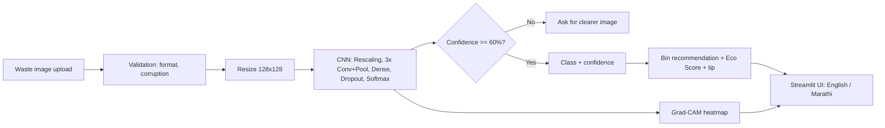

# ♻️ EcoVision – Smart Waste Detection and Segregation System Using CNN

## 1. Abstract
Improper waste segregation is a major urban environmental problem because citizens often cannot tell which bin a given item belongs in. EcoVision is a deep-learning web application that classifies a photograph of waste into five categories (plastic, paper, glass, metal and organic) using a Convolutional Neural Network (CNN) built with TensorFlow/Keras. Images are resized to 128×128 pixels and normalised inside the network; the training set is expanded with rotation, flipping, zoom, shifting and brightness augmentation, while validation and test sets stay untouched and are split by file before training to prevent data leakage. The CNN has three Conv2D–ReLU–MaxPooling blocks followed by a dense layer, dropout and a softmax output. Performance is evaluated using accuracy and loss curves, a confusion matrix, precision, recall and F1-score on a held-out test set. A Streamlit interface lets users upload an image, view the predicted class with a confidence score, the recommended disposal bin, recycling information, an environmental tip and a heuristic Eco Score. Grad-CAM heatmaps explain which image regions influenced the decision, and the interface is available in English and Marathi. Low-confidence predictions are rejected with a request for a clearer image. EcoVision demonstrates how computer vision can support citizen awareness and smart-city waste management.

## 2. Problem statement
People often do not know whether an item is wet, dry or recyclable waste. Mixed waste reduces recycling efficiency and increases landfill load. EcoVision recognises waste from an image and recommends the correct disposal category.

## 3. Objectives
1. Build a CNN that classifies images into 5 waste categories.
2. Apply preprocessing, normalisation and augmentation to improve generalisation.
3. Evaluate honestly with accuracy, loss curves, confusion matrix, precision, recall and F1.
4. Map each prediction to a disposal bin, recycling info and an Eco Score.
5. Explain predictions visually with Grad-CAM.
6. Deliver an English/Marathi Streamlit app with robust error handling.
7. Keep the project reproducible and deployable to the cloud.

## 4. Proposed solution and system architecture

(GitHub renders the diagram above; for slides, paste the block into https://mermaid.live and export PNG.)

## 5. Dataset
Kaggle **"Garbage Classification"** (12 classes: battery, biological, brown-glass, cardboard, clothes, green-glass, metal, paper, plastic, shoes, trash, white-glass). `prepare_dataset.py` maps it to 5 classes: `biological→organic`; `brown/green/white-glass→glass`; `cardboard+paper→paper`; `plastic`; `metal`; the other classes are dropped. It splits **70/15/15** into `dataset/train|val|test/<class>/` with a fixed seed. Check the dataset's licence on Kaggle and cite it in your report. Public datasets can contain near-duplicate images; if your test accuracy looks suspiciously high, mention this limitation.

## 6. CNN architecture
`Input(128,128,3) → Rescaling(1/255) → Conv2D(32)+ReLU → MaxPool → Conv2D(64)+ReLU → MaxPool → Conv2D(128, "last_conv")+ReLU → MaxPool → Flatten → Dense(128)+ReLU → Dropout(0.5) → Dense(5, softmax)`

## 7. Training methodology
Adam (lr 1e-3), sparse categorical cross-entropy, batch 32, up to 30 epochs, EarlyStopping on validation loss (best weights restored), ReduceLROnPlateau, class weights for imbalance, augmentation on training data only.

## 8. Technologies
Python, TensorFlow/Keras, NumPy, Pandas, OpenCV, Matplotlib/Seaborn, Scikit-learn, Pillow, Streamlit.

## 9. Installation
```bash
python -m venv .venv
source .venv/bin/activate        # Windows: .venv\Scripts\activate
pip install -r requirements.txt
```

## 10. How to run
```bash
# 1. Download the Kaggle dataset and unzip it, e.g. to ./dataset_raw
python prepare_dataset.py dataset_raw
# 2. Train (creates model/ecovision_cnn.keras, class_names.json, metrics.json, reports/*.png)
jupyter notebook notebooks/model_training.ipynb      # Run All
# 3. Launch the app
streamlit run app/app.py
```
The app refuses to start predictions until a trained model exists; it never fakes results.

## 11. Model evaluation
All numbers are produced by the notebook and saved in `model/metrics.json` and `reports/`. **Copy your real values here after training:**

| Metric | Value |
|---|---|
| Training / Validation / Test accuracy | _fill from metrics.json_ |
| Training / Validation / Test loss | _fill from metrics.json_ |
| Macro precision / recall / F1 | _fill from metrics.json_ |

Figures: `reports/accuracy_curve.png`, `reports/loss_curve.png`, `reports/confusion_matrix.png`.
When writing "Results", discuss: which classes are confused (see matrix), gap between training and validation curves (overfitting?), and the effect of augmentation.

## 12. Eco Score (heuristic)
Fixed scores per class: glass 90, metal 90, paper 85, organic 80, plastic 60, based on recyclability and general end-of-life burden. It is **not** a scientifically validated measure (see `utils/config.py`).

## 13. Screenshots
`[Add: home/dashboard]  [Add: prediction result]  [Add: Grad-CAM]  [Add: Marathi mode]`

## 14. Future scope
Real-time camera detection; IoT smart bins with automated lids; multiple objects per image (object detection); mobile app; cloud deployment with a prediction history database; smart-city integration; transfer learning (MobileNetV2/EfficientNet) for higher accuracy; more Indian-context classes (e-waste, sanitary, biomedical).

## 15. Conclusion
EcoVision shows an end-to-end deep-learning pipeline, from data preparation and CNN training to explainable, bilingual deployment, applied to a real civic problem.

---
## Presentation outline (10 slides)
1. Title and team · 2. Problem · 3. Objectives · 4. Dataset and class mapping · 5. Pipeline/architecture diagram · 6. CNN architecture · 7. Training and augmentation · 8. Results (your real graphs and confusion matrix) · 9. Live demo: **Image → CNN → Prediction → Confidence → Bin → Eco Score → Grad-CAM** · 10. Limitations, future scope, conclusion.

## Viva Q&A
**Why CNN and not SVM/random forest?** Convolutions learn spatial features (edges, textures) with shared weights, which suits images far better than flattened pixel vectors.
**What do Conv, ReLU, pooling do?** Conv extracts local features; ReLU adds non-linearity; max-pooling reduces size and gives small translation invariance.
**Why softmax?** It outputs a probability distribution over the 5 classes.
**Why dropout?** It randomly disables neurons during training to reduce overfitting.
**What is data augmentation and why only on training data?** It creates varied versions of images to improve generalisation; evaluation data must reflect real, unmodified images.
**What is data leakage and how did you avoid it?** Test information influencing training; we split files into separate folders before any augmentation.
**Why a confusion matrix, not just accuracy?** It shows which classes are confused and exposes imbalance problems.
**What is Grad-CAM?** It weights the last conv layer's feature maps by the gradient of the predicted class score, giving a heatmap of influential regions.
**What if confidence is low?** Below 60% the app rejects the prediction and asks for a clearer image.
**How is Eco Score computed?** A documented fixed heuristic per class, not a scientific measurement.
**Limitations?** One object per image, studio-style dataset images vs. real-world clutter, and a plastic/glass/metal reflection confusion risk.
**How would you improve it?** Transfer learning, more varied data, object detection, and camera deployment.

## Deploy to Streamlit Community Cloud
1. Train locally; confirm `model/ecovision_cnn.keras`, `class_names.json`, `metrics.json` exist (they must be committed; `dataset/` is git-ignored).
2. Create a GitHub repo and push: `git init && git add . && git commit -m "EcoVision" && git remote add origin <url> && git push -u origin main`. (Files over 100 MB need Git LFS; this small CNN is far below that.)
3. Go to https://share.streamlit.io, sign in with GitHub, click **New app**, choose the repo, branch `main`, main file `app/app.py`.
4. Deploy. If the build fails on TensorFlow, pin versions in `requirements.txt` to the ones you trained with (`pip freeze | grep -i -E "tensorflow|keras"`) and select Python 3.11 in Advanced settings.
Alternative: Hugging Face Spaces (Streamlit SDK) using the same files.
